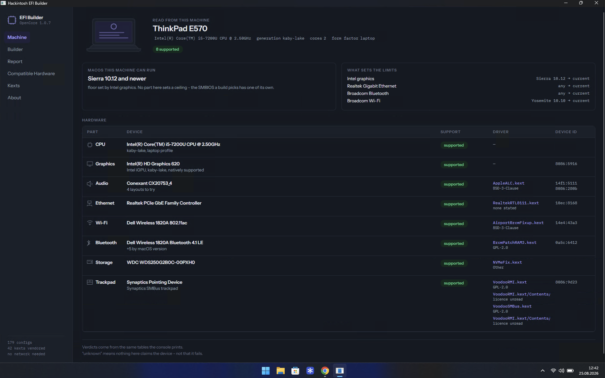
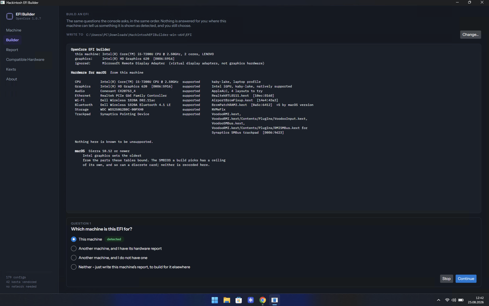
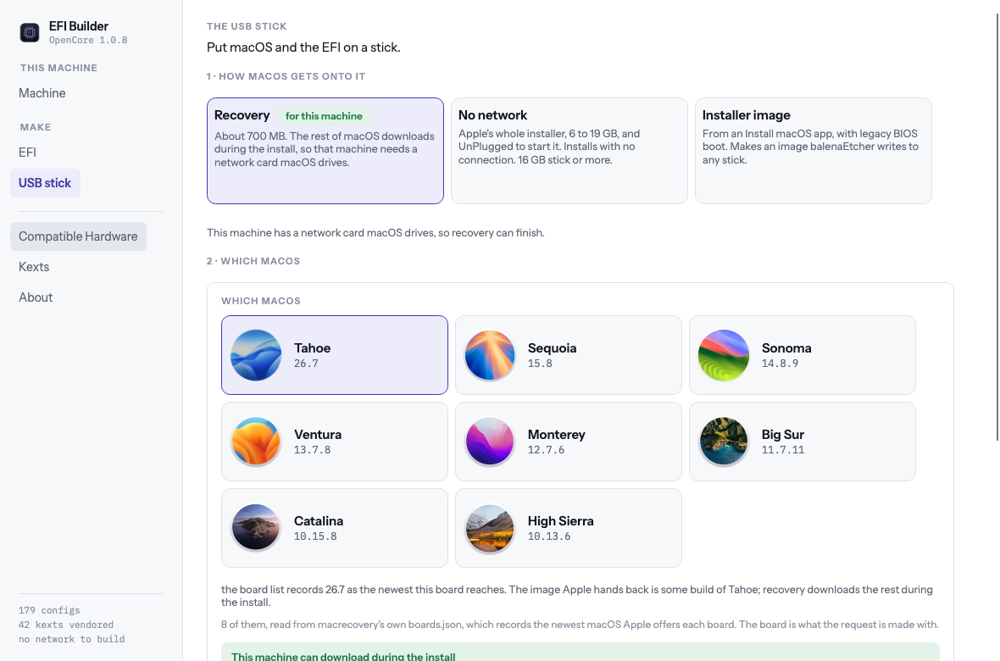
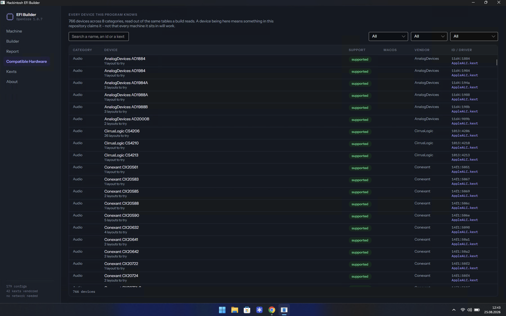
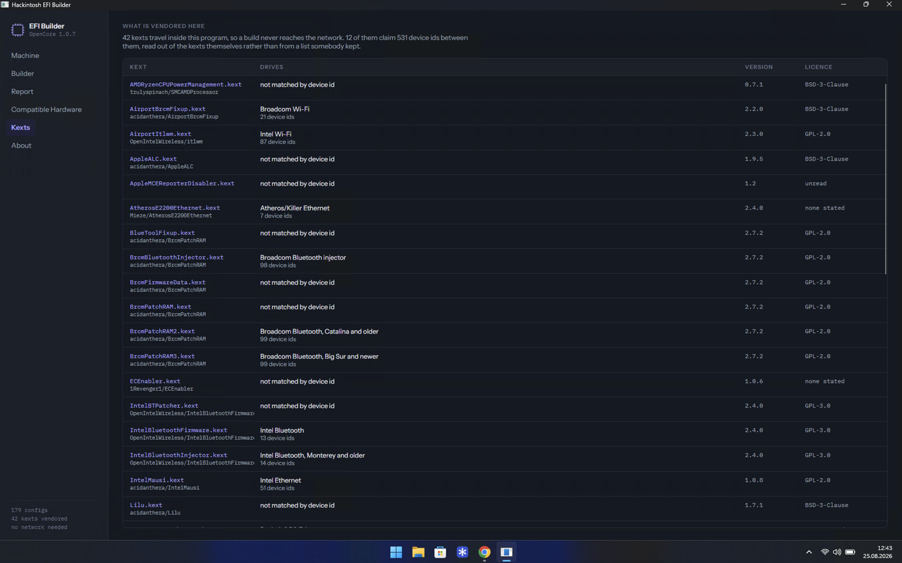
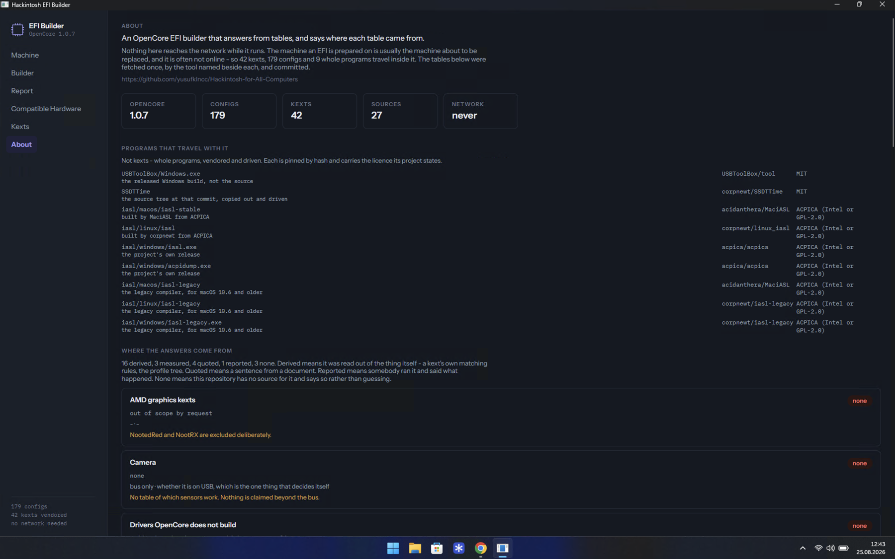

# The app

Everything is in one download. Take the package for your system from
[Releases](https://github.com/yusufklncc/Hackintosh-for-All-Computers/releases),
unzip it, and run it.

=== "Windows"

    `HackintoshEFIBuilder-win-x64.zip`

    Unzip it anywhere and run `HackintoshEFIBuilder.exe`.

=== "macOS"

    `HackintoshEFIBuilder-osx-arm64.zip` for Apple silicon,
    `HackintoshEFIBuilder-osx-x64.zip` for Intel.

    Unzip it, drag `HackintoshEFIBuilder.app` into your Applications folder,
    and open it from there.

=== "Linux"

    `HackintoshEFIBuilder-linux-x64.AppImage`

    ```
    chmod +x HackintoshEFIBuilder-linux-x64.AppImage
    ./HackintoshEFIBuilder-linux-x64.AppImage
    ```

    Or `HackintoshEFIBuilder-linux-x64.zip`, unzipped and run.

No .NET, no Python, no runtime of any kind. Each package carries two programs -
`HackintoshEFIBuilder`, the window, and `EFIBuilderEngine`, the builder it
runs. Keep them together.

The window reimplements none of the builder. It runs the same program a
terminal runs and draws its answers, so a screen here cannot say something the
console would not.

!!! warning "The first run is refused, on Windows and on macOS"
    Neither program is signed by a company that pays Microsoft or Apple. That
    is one dialog on each system, and [When your system blocks
    it](blocked.md) has the steps.

## The six panes

In the order the work goes - the machine, the EFI for it, the stick it boots
from - and then three that are there to look things up.

### Machine

Where it opens: the model name, what each part is, whether macOS drives it,
which kext does the driving, and the oldest macOS this hardware can boot
together with the part that sets that floor.

`unknown` means no table here claims the device - not that it fails.

Under the table, **Save this machine's report** reads this machine into a single
JSON file and dumps its ACPI tables beside it - the file to carry to the
computer you build on. It holds no serial numbers and no raw device dump, so it
is safe to send to someone who is helping you. **Open a report** does the other
half: the pane then shows that machine, and the EFI builder and the USB stick
advice are about it too.

[Building for another machine :material-arrow-right:](another-machine.md){ .md-button }



### EFI

Asks the questions and writes the EFI folder. It answers none of them for you:
where the machine can tell it something the option is marked *detected*, and you
still choose.

[Get your EFI :material-arrow-right:](efi.md){ .md-button }



### USB stick

Puts macOS and the EFI on a stick, in three steps: how macOS gets onto it, which
macOS, which stick. The first step offers three ways, and marks the one that
fits the machine being installed:

- **Recovery** - about 700 MB that boots and downloads the rest of macOS during
  the install, so that machine needs a network card macOS drives. It is
  downloaded straight onto the stick, beside the EFI.
- **No network** - Apple's whole installer and UnPlugged, for a machine with no
  network macOS can use. See [A stick that needs no network](offline.md).
- **Installer image** - from an Install macOS app, with legacy BIOS boot, as an
  image balenaEtcher writes to any stick. macOS only, because Apple's
  `createinstallmedia` is a Mac program; it is the one place that asks for an
  administrator password, and it shows the script first. See
  [Building the stick on a Mac](mac-installer.md).

Which way is marked comes from the machine's network: recovery pulls macOS down
*on that machine*, so a laptop whose only card is a Realtek Wi-Fi boots the
installer and then stops. If its Ethernet is driven it says to use a cable.

It lists removable disks only, never the one the computer booted from, erases
in the layout the chosen way needs, and asks for the disk by its own name
before it starts.



### Compatible Hardware

Lists 772 devices across 8 categories - everything this repository knows -
searchable by name, id or kext, and filterable by category, vendor and support.
It is read out of the same tables a build reads, so it cannot drift from what
the builder would do.



### Kexts

Lists the 42 kexts that ship inside the program, with the project each comes
from, its version, its licence, and how many device ids it claims - read out of
the kexts themselves rather than from a list somebody kept.



### About

Names where every answer comes from: which tool fetched each table, whether it
was derived, measured, quoted or reported - and the areas with no source at all,
said plainly instead of guessed.


